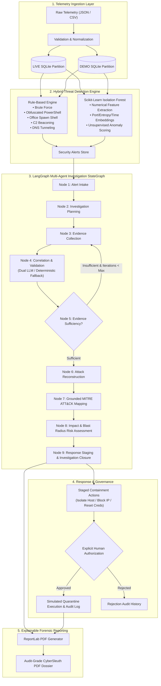
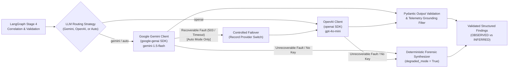

# CyberSleuth: System Architecture & Technical Specifications

> **Academic Reference Document:** Evidence-Driven, LLM-Assisted Multi-Agent Cybersecurity Investigation Platform

---

## 1. High-Level Architecture

CyberSleuth is designed with an evidence-first, modular architecture separating the reactive ingestion pipeline, hybrid detection layer, stateful multi-agent investigation orchestration, and human-in-the-loop incident containment.



---

## 2. Dual Live LLM Reasoning & Failover Engine

CyberSleuth natively supports both **Google Gemini** and **OpenAI** inside the LangGraph forensic reasoning workflow:



### Key Routing & Failover Specifications:
1. **Primary Provider:** Google Gemini (`google-genai` SDK).
2. **Secondary Provider:** OpenAI (`openai` SDK with Windows AppLocker DLL compatibility guard).
3. **Automatic Mode (`auto`):** Directs inference to Gemini; on recoverable fault (e.g. 503 Service Unavailable, connection timeout), logs provider switch and fails over to OpenAI.
4. **Strict Non-Silent Failover Policy:** Unrecoverable faults (invalid credentials, 401 auth, invalid model, quota exhausted) are **never** silently routed to secondary providers; they surface explicit errors in step history.
5. **Deterministic Forensic Fallback:** If both fail or credentials are unconfigured, CyberSleuth falls back to a deterministic forensic synthesizer with explicit `degraded_mode = True` and provider label `DETERMINISTIC_FALLBACK`.

---

## 3. LangGraph Investigation StateGraph Schema

The investigation workflow is modeled as a compiled `langgraph.graph.StateGraph` consuming a typed `InvestigationState`.

```python
class InvestigationState(TypedDict):
    investigation_id: str
    alert_id: str
    is_demo: bool
    current_stage: str
    progress: int
    iteration_count: int
    max_iterations: int
    alert_data: Dict[str, Any]
    target_entities: List[Dict[str, Any]]
    collected_events: List[Dict[str, Any]]
    evidence_items: List[Dict[str, Any]]
    graph_nodes: List[Dict[str, Any]]
    graph_edges: List[Dict[str, Any]]
    hypotheses: List[Dict[str, Any]]
    findings: List[Dict[str, Any]] # Flagged OBSERVED vs INFERRED
    missing_evidence: List[Dict[str, Any]]
    sufficiency_reached: bool
    attack_reconstruction: Dict[str, Any]
    mitre_mappings: List[Dict[str, Any]]
    risk_assessment: Dict[str, Any]
    executive_summary: Optional[str]
    response_recommendations: List[Dict[str, Any]]
    llm_invoked: bool
    llm_provider: Optional[str]
    llm_model: Optional[str]
    degraded_mode: bool
    provider_switches: List[Dict[str, Any]]
    failover_reason: Optional[str]
    status: str
    errors: List[str]
```

---

## 4. Epistemological Provenance Standard

To prevent hallucinations in AI cybersecurity investigations, every finding and graph edge adheres strictly to the **CyberSleuth Provenance Standard**:

| Category | Definition | Required Provenance | Visual Representation |
| :--- | :--- | :--- | :--- |
| **OBSERVED** | Empirical facts directly recorded in ingested telemetry logs. | Explicit cited Event IDs (e.g. `EVT-CC-101`) | Solid Neon Cyan line (`#00D5C5`) |
| **INFERRED** | Logical conclusions derived from correlation, temporal proximity, or statistical anomaly. | Multiple supporting observed events + formal reasoning statement (confidence <= 0.95) | Dashed Amber line (`#FFB454`) |
| **UNKNOWN** | Hypothesized or unverified conditions lacking telemetry support. | Labeled as gap in sufficiency assessment; triggers iterative collection | Dim Muted Sage (`#91AAA5`) |

---

## 5. Database Schema & Partitioning

CyberSleuth enforces separation between user telemetry and synthetic demo datasets at the SQLite database level:

```sql
-- Telemetry Table
CREATE TABLE telemetry_events (
    id VARCHAR PRIMARY KEY,
    timestamp DATETIME NOT NULL,
    event_type VARCHAR NOT NULL,
    severity VARCHAR DEFAULT 'INFO',
    user VARCHAR,
    host VARCHAR,
    source_ip VARCHAR,
    destination_ip VARCHAR,
    source_port INTEGER,
    destination_port INTEGER,
    protocol VARCHAR,
    process_name VARCHAR,
    process_path VARCHAR,
    parent_process VARCHAR,
    command_line TEXT,
    domain VARCHAR,
    hash VARCHAR,
    raw_payload JSON,
    is_demo BOOLEAN NOT NULL DEFAULT 0, -- Strict partition separator
    dataset_source VARCHAR,
    created_at DATETIME
);
```
